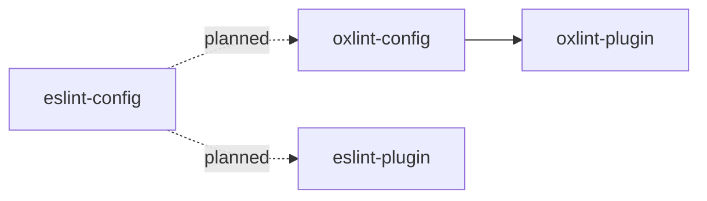
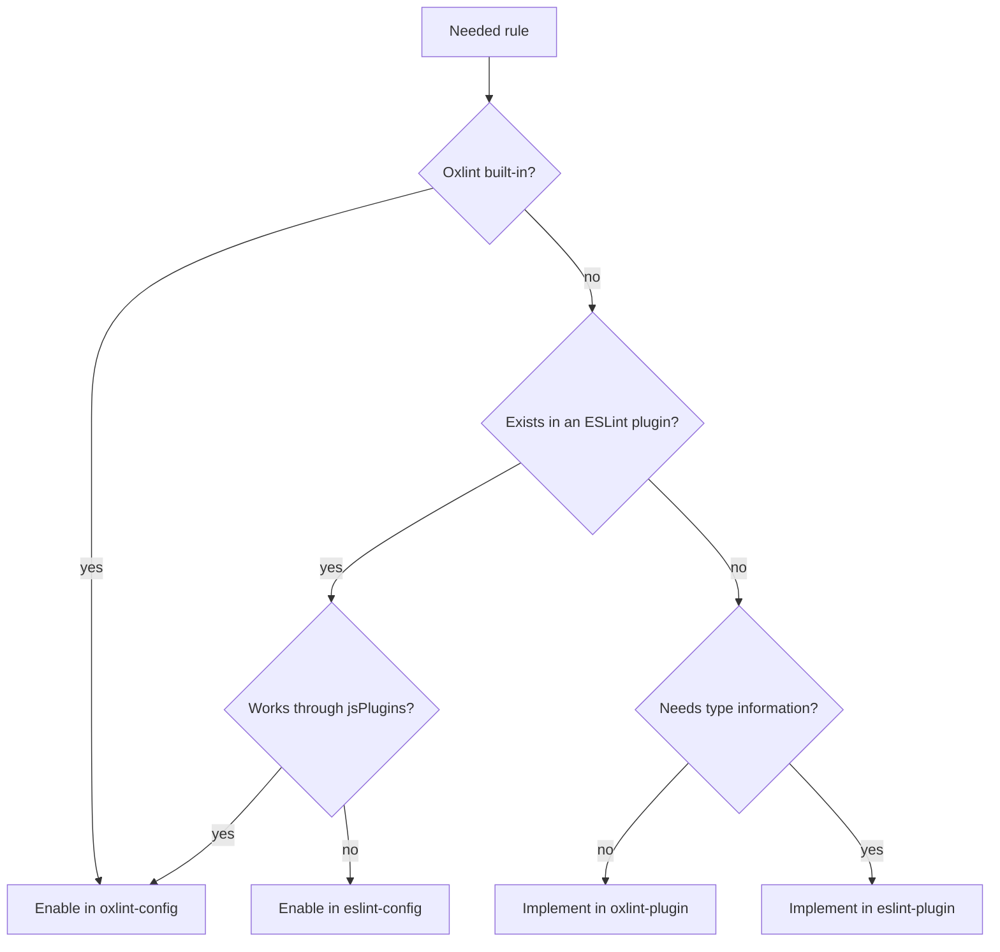

# Architecture

This document describes how the packages in this repository fit together and which rules they must keep. Reasons for the decisions are in [docs/decisions](docs/decisions). Upstream behavior that the design depends on is in [docs/reference/oxlint-constraints.md](docs/reference/oxlint-constraints.md).

## Bird's eye view

Oxlint is the primary linter. ESLint runs only the rules Oxlint cannot run. Formatting is done by oxfmt, never by lint rules.

| Layer | Runs in | Type information |
| --- | --- | --- |
| Oxlint built-in rules | Oxlint | Yes, through tsgolint |
| `@sonsu-lee/oxlint-plugin` (custom AST rules) | Oxlint as a JS plugin; also runs in ESLint | No |
| `@sonsu-lee/eslint-plugin` (custom typed rules, planned) | ESLint only | Yes, through typescript-eslint |

Packages are split by the linter that runs them, not by rule topic.

| Package | Rule namespace | Status |
| --- | --- | --- |
| `@sonsu-lee/oxlint-config` | — | Scaffold |
| `@sonsu-lee/oxlint-plugin` | `sonsu-lee` | Scaffold, no rules yet |
| `@sonsu-lee/eslint-plugin` | `sonsu-lee-eslint` | Planned for the first rule that needs type information |
| `@sonsu-lee/eslint-config` | — | Planned with `eslint-plugin` |
| `@sonsu-lee/oxfmt-config` | — | Planned when formatter settings need to be shared |

## Where a new rule goes

An external ESLint plugin is enabled in exactly one of `oxlint-config` and `eslint-config`. `eslint-plugin-oxlint` does not turn off rules that Oxlint runs through `jsPlugins`, so enabling it in both runs the rules twice.

## Code map

### `packages/oxlint-config`

| Path | Contents |
| --- | --- |
| `src/index.ts` | Public API. Exports only `preset` and the `Options` type |
| `src/preset.ts` | Builds the root config: root-only fields, then the selected configs, then the user's config |
| `src/configs/*.ts` | One file per profile. Only fields that `extends` inherits |
| `src/ignores.ts` | Default ignore patterns |

### `packages/oxlint-plugin`

| Path                          | Contents                                      |
| ----------------------------- | --------------------------------------------- |
| `src/index.ts`                | `eslintCompatPlugin({ meta, rules })`         |
| `src/rules/<rule-id>.ts`      | One rule, written with `createOnce`           |
| `src/rules/<rule-id>.test.ts` | `RuleTester` cases taken from the rule's docs |
| `docs/rules/<rule-id>.md`     | Code the rule reports and code it allows      |

## Invariants

- **`preset()` returns a root config.** It is never meant to be placed inside another config's `extends`.
- **Fields go where Oxlint inherits them.** `src/configs/` holds only `rules`, `plugins`, `jsPlugins`, `overrides`, and `categories`. `src/preset.ts` sets `ignorePatterns`, `env`, `globals`, `settings`, and `options`, because `extends` does not inherit them.
- **Profile configs are not exported.** Exporting them would invite use through `extends`, which loses the root-only fields.
- **Profiles own their plugins.** Root-level `plugins` replaces Oxlint's default plugin set, while `plugins` inside `extends` can only add to it. When the first profile option is added, `preset()` sets `plugins: []` at the root and each profile config adds the plugins it needs.
- **The custom plugin is registered with an alias**: `{ name: "sonsu-lee", specifier: "@sonsu-lee/oxlint-plugin" }`. Relative specifiers are rejected inside `extends`, and an unaliased scoped package gets the namespace `@sonsu-lee`.
- **External JS plugins live only in the profiles that need them.** JS plugins cost load time, so `base` does not include them.
- **Lint does not do the formatter's job.** Rules that overlap with oxfmt, such as `sort-imports`, stay off.

## Merging `userConfig`

| Field | Behavior |
| --- | --- |
| `options.ignores` | Appended after the default ignore patterns |
| `ignorePatterns` | Appended after `options.ignores` |
| `extends` | Placed after the preset's configs, so it takes precedence |
| `rules` | Kept at the root, where it overrides inherited rules |
| `env`, `globals`, `settings` | Merged by key, user values win (when the preset starts setting them) |
| `options` | User values win |

These rules are covered by `packages/oxlint-config/src/preset.test.ts`.

## Cross-cutting concerns

- **Versions.** `oxlint` and `@oxlint/plugins` move together; both come from the workspace catalog. All packages share one version number.
- **Breaking changes.** Enabling a rule or raising a severity changes users' results. Such changes bump the major version, or the minor version while in 0.x.
- **TypeScript.** tsgolint ships its own TypeScript 7 compiler, so type-aware rules work in projects that install TypeScript 6. typescript-eslint rejects TypeScript 7, so the planned ESLint packages will use TypeScript 6.
- **Development toolchain.** Node.js is pinned by `.node-version` and `devEngines.runtime`; pnpm by `packageManager`. Tool-specific files such as `mise.toml` are not committed. Setup details are in [CONTRIBUTING.md](CONTRIBUTING.md#setup).
