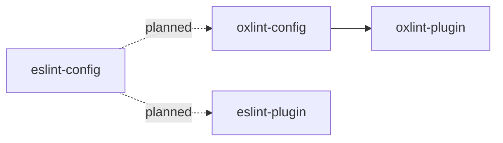
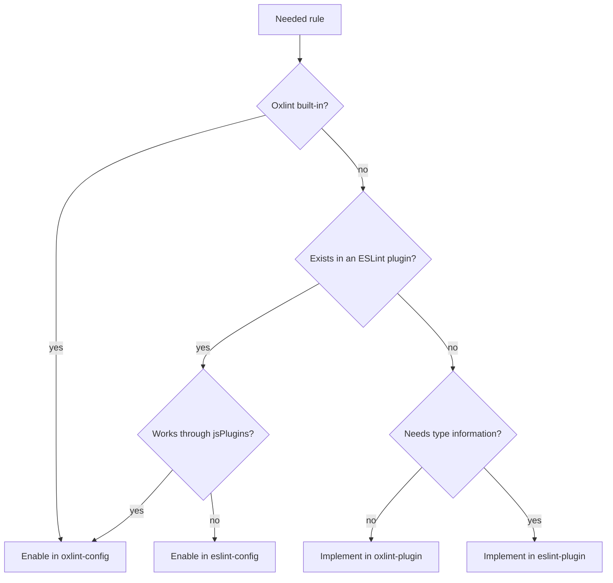

# Architecture

This document describes how the packages in this repository fit together and which rules they must keep. Reasons for the decisions are in [docs/decisions](docs/decisions). Upstream behavior that the design depends on is in [docs/reference/oxlint-constraints.md](docs/reference/oxlint-constraints.md).

## Bird's eye view

Oxlint is the primary linter. ESLint runs only the rules Oxlint cannot run. Formatting is done by oxfmt, never by lint rules.

| Layer | Runs in | Type information |
| --- | --- | --- |
| Oxlint built-in rules | Oxlint | Yes, through tsgolint |
| `@sonsu-lee/oxlint-plugin` (custom AST rules) | Oxlint as a JS plugin; also runs in ESLint | No |
| `@sonsu-lee/eslint-plugin` (custom typed rules, planned) | ESLint only | Yes, through typescript-eslint |

Packages are split by the linter that runs them, not by rule topic.

| Package | Rule namespace | Status |
| --- | --- | --- |
| `@sonsu-lee/oxlint-config` | — | Unpublished |
| `@sonsu-lee/oxlint-plugin` | `sonsu-lee` | One rule: `no-double-assertion` |
| `@sonsu-lee/eslint-plugin` | `sonsu-lee-eslint` | Planned for the first rule that needs type information |
| `@sonsu-lee/eslint-config` | — | Planned with `eslint-plugin` |
| `@sonsu-lee/oxfmt-config` | — | Planned when formatter settings need to be shared |

## Where a new rule goes

An external ESLint plugin is enabled in exactly one of `oxlint-config` and `eslint-config`. `eslint-plugin-oxlint` does not turn off rules that Oxlint runs through `jsPlugins`, so enabling it in both runs the rules twice.

## Code map

### `packages/oxlint-config`

| Path | Contents |
| --- | --- |
| `src/index.ts` | Public API. Exports only `preset` and the `Options` type |
| `src/preset.ts` | Builds the root config: root-only fields, then the selected configs, then the user's config |
| `src/configs/*.ts` | One file per profile with inherited fields; `browser` has none and only sets `env.browser` |
| `src/ignores.ts` | Default ignore patterns |
| `src/profiles.test.ts` | Lints generated files with each option to check which plugins, files, and environments a profile covers |

### `packages/oxlint-plugin`

| Path                          | Contents                                      |
| ----------------------------- | --------------------------------------------- |
| `src/index.ts`                | `eslintCompatPlugin({ meta, rules })`         |
| `src/rules/<rule-id>.ts`      | One rule, written with `createOnce`           |
| `src/rules/<rule-id>.test.ts` | `RuleTester` cases taken from the rule's docs |
| `docs/rules/<rule-id>.md`     | Code the rule reports and code it allows      |

## Invariants

- **`preset()` returns a root config.** It is never meant to be placed inside another config's `extends`.
- **Fields go where Oxlint inherits them.** `src/configs/` holds only `rules`, `plugins`, `jsPlugins`, `overrides`, and `categories`. `src/preset.ts` sets `ignorePatterns`, `env`, `globals`, `settings`, and `options`, because `extends` does not inherit them.
- **Profile configs are not exported.** Exporting them would invite use through `extends`, which loses the root-only fields.
- **Profiles own their plugins.** Root-level `plugins` replaces Oxlint's default plugin set, while `plugins` inside `extends` can only add to it. `preset()` sets the root `plugins` to `[]` (or the user's list) to remove the defaults, and each config in `src/configs/` adds the plugins it needs. Every config sets `plugins`, even to `[]`, because Oxlint adds its default plugins for a config that omits it.
- **Profile order is fixed**: base, typescript, typeAware, node, react, vitest, nestjs, then the user's `extends`. Later configs win, so a framework profile can change the rules of the language and runtime profiles before it.
- **Rules come from Oxlint categories.** base turns on `correctness`, `suspicious`, `perf`, and `pedantic`; profiles add plugins, and set a rule only to turn off or relax a duplicate or a rule that reports standard code of the stack, or to choose the options of a rule the categories turn on, with the reason next to it. See [ADR 0005](docs/decisions/0005-profile-rule-sources.md).
- **Type-aware linting is the default.** `typescript` and `typeAware` are on unless `typescript: false`, so profiles may assume type information.
- **The custom plugin is registered with an alias and a resolved URL**: `{ name: 'sonsu-lee', specifier: import.meta.resolve('@sonsu-lee/oxlint-plugin') }`. Oxlint resolves a package name from the directory of the user's root config, so a project that installs only the preset finds the plugin only through the `NODE_PATH` that pnpm's bin shim sets. Relative specifiers are rejected inside `extends`. An unaliased scoped package gets the namespace `@sonsu-lee`.
- **External JS plugins live only in the profiles that need them.** JS plugins cost load time, so `base` does not include them. `base` registers only `@sonsu-lee/oxlint-plugin`.
- **`sonsu-lee/no-double-assertion` overlaps `typescript/no-unsafe-type-assertion` on purpose.** Outside test files both report a double assertion. The custom rule stays on everywhere because it still checks two places the type-aware rule does not: test files, where the vitest profile turns that rule off, and lines where a disable comment turns it off. Allowing a narrowing assertion does not also allow throwing the type away through `unknown`.
- **Lint does not do the formatter's job.** Rules that overlap with oxfmt, such as `sort-imports`, stay off.

## Merging `userConfig`

| Field                 | Behavior                                                             |
| --------------------- | -------------------------------------------------------------------- |
| `options.ignores`     | Appended after the default ignore patterns                           |
| `ignorePatterns`      | Appended after `options.ignores`                                     |
| `extends`             | Placed after the preset's configs, so it takes precedence            |
| `rules`               | Kept at the root, where it overrides inherited rules                 |
| `plugins`             | Kept at the root; Oxlint adds the plugins of the selected profiles   |
| `env`                 | Merged by key over the profiles' environments; user values win       |
| `globals`, `settings` | Merged by key, user values win (when the preset starts setting them) |
| `options`             | User values win                                                      |

These rules are covered by `packages/oxlint-config/src/preset.test.ts`.

## Cross-cutting concerns

- **Versions.** `oxlint` and `@oxlint/plugins` move together; both come from the workspace catalog. All packages share one version number.
- **Breaking changes.** Enabling a rule or raising a severity changes users' results. Such changes bump the major version, or the minor version while in 0.x.
- **TypeScript.** tsgolint ships its own TypeScript 7 compiler, so type-aware rules work in projects that install TypeScript 6. typescript-eslint rejects TypeScript 7, so the planned ESLint packages will use TypeScript 6.
- **Development toolchain.** Node.js is pinned by `.node-version` and `devEngines.runtime`; pnpm by `packageManager`. Tool-specific files such as `mise.toml` are not committed. Setup details are in [CONTRIBUTING.md](CONTRIBUTING.md#setup).
